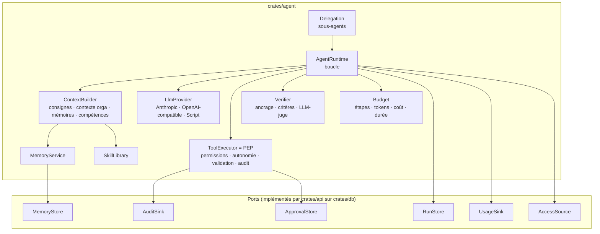

# Moteur agentique et mémoire

Code : `crates/agent` (moteur), `crates/core` (autorisation, autonomie, contrat
d'outil), `crates/connectors` (outils), `crates/api/src/services/runs` (exécution et
ports PostgreSQL). Statut des briques : [ROADMAP.md](ROADMAP.md).

## 1. Principes

1. **Le modèle propose, la plateforme dispose** : chaque appel d'outil passe par un
   point d'application des politiques (PEP) indépendant du modèle.
2. **Contexte minimal et autorisé** : seules les données que l'utilisateur peut voir
   entrent dans le contexte.
3. **Tout est borné** : étapes, tokens, coût, durée, tentatives de correction,
   profondeur et parallélisme des sous-agents.
4. **Tout est persisté** : chaque étape est enregistrée ; une exécution peut être
   rejouée, auditée et reprise.
5. **Rien n'est appris sans validation** : mémoire partagée et compétences passent par
   un statut « proposé » avant d'être actives.

## 2. Composants



## 3. Boucle d'exécution

```
run(objective, subject, options)
  contexte ← ContextBuilder(subject)            # consignes fixes + contexte orga + mémoires + index des compétences
  tant que non terminé :
    Budget.vérifier()                           # étapes, tokens, coût, durée → arrêt propre si dépassé
    sujet ← AccessSource.actuel()               # droits relus ; plus le droit d'agir → arrêt (ADR-035)
    réponse ← LLM(contexte, outils visibles par le sujet)
    si appels d'outils :
      sujet ← AccessSource.actuel()             # relus encore : la réponse a pu prendre du temps
      pour chaque appel :
        décision ← PEP(sujet, outil, entrée)
        allow            → exécuter (délai max, signal d'annulation), résultat balisé NON FIABLE
        require_approval → créer la demande, suspendre le run (awaiting_approval)
        deny             → renvoyer le refus motivé au modèle (il adapte son plan)
      persister l'étape ; continuer
    sinon (réponse finale candidate) :
      sujet ← AccessSource.actuel()             # relus avant le juge et la conclusion
      verdict ← Verifier(objectif, critères, réponse, preuves collectées)
      si verdict OK → terminer
      sinon si tentatives < max → injecter la critique, continuer (correction)
      sinon → terminer en signalant honnêtement les points non vérifiés
```

**Outils visibles** : un outil n'est proposé au modèle que si le sujet détient ses
permissions requises (dans au moins un périmètre) et que le niveau d'autonomie ne
l'interdit pas. Le PEP revérifie à l'exécution (défense en profondeur).

**Droits relus à chaque étape** (ADR-035) : le sujet n'est pas figé au démarrage. Le port
`AccessSource` le relit avant chaque appel au modèle, avant les appels d'outils qu'il
renvoie, avant de conclure une réponse et à la reprise après validation. Un compte
désactivé, ou privé du droit d'utiliser l'assistant (`agent:use`), arrête le run à ce
moment, avec son motif (une entreprise suspendue aussi, dans les 30 s au plus) ; une habilitation retirée ne compte plus, ni pour les outils
proposés ni pour les appels encore demandés. Ce que le run détient déjà (consignes,
mémoires rappelées au démarrage, résultats obtenus) reste dans sa conversation.

**Reprise après un arrêt du service** (ADR-053) : l'état d'un run est enregistré dès son
démarrage puis à chaque étape. Au démarrage, l'API reprend les runs qu'un arrêt a
interrompus depuis leur dernière étape enregistrée, si rien d'autre qu'une lecture
n'avait été lancé depuis ; sinon le run échoue en nommant l'action dont l'effet est à
vérifier (de même pendant des actions validées, après deux reprises, avant toute
étape enregistrée ou après plus d'une heure d'interruption). Les validations en attente
de l'étape perdue sont annulées et cette annulation est auditée. Le risque de chaque
outil appelé est enregistré dans l'événement `tool_call` ; un appel n'est jugé lecture
que si ce risque et celui de l'outil, s'il est encore présent, sont tous deux `read`.
Toute fin nomme les actions dont l'effet est à vérifier. L'API tient un verrou
d'exécution des runs : un second processus sur la même base refuse de démarrer.

**Connecteurs indisponibles** (ADR-048) : un connecteur de l'entreprise qui ne démarre
pas (serveur injoignable, politiques illisibles…) laisse le run sans ses outils. S'il
est à la portée de l'utilisateur (un serveur MCP pour qui détient `connector:use`, un
autre type pour qui détient l'une des permissions qu'il introduit), le run qui démarre
le dit : au modèle, par une note `<connecteurs_indisponibles>` en tête du tour
utilisateur (le prompt système reste stable), pour qu'il signale ce qui manque plutôt
que de conclure que l'information n'existe pas ; à l'utilisateur, par l'événement
`connectors_unavailable` du suivi en direct.

**Résultats d'outils** : transmis au modèle comme **données**, encadrés par un
marqueur `<donnees_outil source="…" fiabilite="non_fiable">` ; les consignes système
rappellent qu'aucune instruction contenue dans des données ne doit être suivie. Seule
exception : la compétence chargée par `skill_read`, procédure que l'entreprise a écrite
et rendue active (ADR-052), encadrée par `<procedure_entreprise>` et suivie pour la tâche
qu'elle couvre, sans pouvoir étendre les droits, éviter une validation ni lever les
règles de sécurité.

**Erreurs** : erreurs d'outil renvoyées au modèle (il peut corriger son appel) ;
erreurs de fournisseur classées (`rate_limit`, `overloaded`, `auth`, `context_overflow`,
`invalid_request`) → nouvelle tentative avec attente exponentielle, bascule vers un
modèle de repli configuré (phase 2), ou arrêt.

## 4. Point d'application des politiques (PEP)

Pour chaque appel d'outil, dans cet ordre :

1. outil connu et activé pour l'entreprise ;
2. validation stricte de l'entrée (structure Rust : serde + validator, champs inconnus refusés) ;
3. **permissions requises** détenues par l'utilisateur **et** autorisées pour l'agent
   (permissions non délégables exclues, plafond du run) ;
4. **niveau d'autonomie** × **risque de l'outil** (`read`, `draft`, `write`, `external`,
   `irreversible`) → `allow`, `require_approval` ou `deny` ;
5. exécution avec un **contexte d'autorisation lié** (`ctx.authz.scope(permission)`) :
   l'outil filtre ses données sur le périmètre du sujet ;
6. journalisation (`tool_invocations`, `audit_log`, `run_events`) et usage.

| Autonomie \ Risque      | read | draft | write                 | external              | irreversible |
| ----------------------- | ---- | ----- | --------------------- | --------------------- | ------------ |
| `read_only`             | ✅   | ⛔    | ⛔                    | ⛔                    | ⛔           |
| `propose`               | ✅   | ✅    | ⛔                    | ⛔                    | ⛔           |
| `execute_with_approval` | ✅   | ✅    | 🔐                    | 🔐                    | 🔐           |
| `autonomous_limited`    | ✅   | ✅    | ✅ si liste, sinon 🔐 | ✅ si liste, sinon 🔐 | 🔐           |

✅ exécuté · 🔐 validation humaine · ⛔ refusé. Un outil peut en plus exiger
systématiquement une validation (`requiresApproval`).

## 5. Validations humaines

- Une demande contient : l'action lisible (« Appliquer le planning de suivi : 4
  interventions, semaine 43 »), les paramètres exacts, le risque, le run d'origine.
- Par défaut, la personne pour qui l'agent agit valide (ou rejette) ses propres
  actions. Une entreprise peut faire valider les actions de certains risques par un
  responsable (ADR-059) : le responsable le plus proche dans l'organisation qui détient
  `approval:decide` sur la personne. Seul lui l'approuve, s'il détient encore ce droit,
  et le run reprend avec les droits de la personne, qui peut retirer sa demande tant
  qu'elle peut utiliser l'agent (l'action n'est pas exécutée). Si personne n'est éligible, l'action est
  refusée aussitôt. Si un relais SMTP est configuré, le responsable est prévenu par
  e-mail, sans le détail de l'action (ADR-060). Restent à faire : délais d'expiration actifs, relances,
  délégations.
- `approval:decide` est **non délégable** : l'agent ne peut jamais valider lui-même.
- Après décision, l'outil est exécuté **avec les paramètres validés** (aucune
  modification possible entre validation et exécution) et le run reprend.
- Une décision n'est enregistrée que si le run est effectivement en pause
  (`awaiting_approval`, ligne verrouillée) : avant, rien ne le reprendrait ; après sa
  fin, l'action ne peut plus être exécutée. Dans les deux cas l'API répond 409 sans
  rien enregistrer.
- Le moteur **enregistre l'issue d'un run** (pause, fin, échec : statut, réponse,
  audit) via `RunStore.finish` **avant** d'émettre `run_finished` : un client qui
  recharge sur cet événement trouve toujours l'état à jour.

## 6. Vérification et correction

Deux niveaux, cumulables :

1. **Contrôles déterministes** (sans LLM, toujours actifs) :
   - _ancrage_ : tout identifiant d'enregistrement cité dans la réponse (ex. `INT-2043`)
     doit figurer dans les résultats d'outils de l'exécution ;
   - complétude des critères structurés (présence des sections demandées…).
2. **Évaluation par un modèle** (missions, ou critères explicites) : un appel séparé,
   éventuellement avec un autre modèle, juge la réponse au regard de l'objectif et des
   critères et renvoie `{ pass, issues[] }` via un outil structuré.

En cas d'échec : la critique est réinjectée comme message système et l'agent corrige,
dans la limite de `maxCorrectionAttempts` (défaut 2). Les échecs résiduels sont
**affichés** à l'utilisateur, jamais masqués. Chaque verdict est enregistré dans
`agent_runs.verification` et alimente l'apprentissage (§8).

## 7. Sous-agents

- Outil `delegate_task` : crée un run enfant avec un profil (`research`, `analysis`,
  `planning`, `quality`…), un objectif, et un **plafond de permissions ⊆ parent**.
- Les enfants ne peuvent pas : déléguer à nouveau (profondeur 1 par défaut), écrire
  dans la mémoire partagée, demander des validations directement, communiquer vers
  l'extérieur. Ils rendent un **résumé** au parent (pas leur transcription).
- Parallélisme borné (défaut 3), budget prélevé sur celui du parent.
- L'utilisateur voit une seule conversation ; le détail des sous-agents est
  consultable dans la vue « opérations ».

## 8. Apprentissage : quatre mécanismes distincts

| Mécanisme                  | Ce qui change                                           | Déclencheur                                                  | Garde-fou                                                                                         |
| -------------------------- | ------------------------------------------------------- | ------------------------------------------------------------ | ------------------------------------------------------------------------------------------------- |
| **Mémoire**                | Faits, préférences, décisions, leçons                   | Demande explicite, ou proposition de l'agent en fin de run   | Personnelle : enregistrée si l'utilisateur l'autorise ; partagée : statut `proposed` → validation |
| **Procédures**             | Mémoire `procedure` / `lesson` de l'espace _expérience_ | Run vérifié avec succès, ou échec corrigé                    | Validation par un gestionnaire des connaissances                                                  |
| **Compétences** (_skills_) | Procédure outillée réutilisable, versionnée             | Répétition d'un même type de mission, proposition de l'agent | Évaluations + non-régression + validation humaine avant activation ; retour arrière               |
| **Modèles**                | Poids d'un modèle (fine-tuning)                         | Hors périmètre initial                                       | Décision produit explicite, données anonymisées, opt-in                                           |

Aucun de ces mécanismes ne peut modifier une permission, une politique, un niveau
d'autonomie ou une consigne de sécurité : ces objets ne sont pas accessibles aux
outils de l'agent (permissions non délégables) et les consignes système ne sont pas
composables par les compétences.

### 8.1 Boucle d'amélioration

1. Mission reçue → objectif et **critères de réussite** explicités (planification).
2. Décomposition en étapes, choix des outils et des compétences.
3. Exécution autorisée, observation.
4. Contrôle (§6) ; correction bornée.
5. **Capitalisation** : le résumé du run (ce qui a marché, erreurs, corrections) est
   proposé comme mémoire `lesson` ; si un schéma récurrent apparaît, l'agent propose
   une compétence (nouvelle version `draft`).
6. **Évaluation** de la version candidate sur les cas `skill_evals` (et cas de
   non-régression des versions précédentes) ; budget d'évaluation plafonné.
7. **Activation** par une personne habilitée (`skill:manage`) ; historique conservé ;
   retour à la version précédente en un geste si les indicateurs se dégradent.

## 9. Mémoire multiniveau

### 9.1 Espaces

| Espace                                       | Visible par                                                                        | Écriture                                    |
| -------------------------------------------- | ---------------------------------------------------------------------------------- | ------------------------------------------- |
| `user` (personnel)                           | Son propriétaire uniquement (et l'agent agissant pour lui)                         | L'utilisateur, l'agent pour lui             |
| `org_unit` (équipe, service)                 | Membres de l'unité et de ses sous-unités ; détenteurs de `memory:read` sur l'unité | `memory:write` sur l'unité                  |
| `tenant` (entreprise)                        | Tous les membres disposant de `memory:read`                                        | `memory:write` à l'échelle de l'entreprise  |
| `experience` (leçons, procédures de l'agent) | Comme `tenant`                                                                     | Proposée par l'agent, validée par un humain |

Un responsable **ne voit pas** la mémoire personnelle de ses collaborateurs.

### 9.2 Recherche

1. **Pré-filtrage SQL** par l'entreprise (RLS) et par le filtre de visibilité calculé
   par `core` (`memoryReadFilter`) — jamais de filtrage après classement seulement.
2. Classement **hybride** : plein texte PostgreSQL (`ts_rank`) et, si un modèle
   d'embedding est configuré, similarité cosinus pgvector ; fusion par rang réciproque
   (RRF).
3. Exclusion des éléments expirés, archivés ou d'une sensibilité supérieure à
   l'habilitation.
4. Injection dans le contexte **avec la source** (identifiant, espace, date) ; mise à
   jour de `last_used_at` / `use_count`.

### 9.3 Cycle de vie

Rétention par type (`expires_at`), consultation et suppression par l'utilisateur
(espace « Ma mémoire »), export (RGPD), archivage des éléments inutilisés plutôt que
suppression silencieuse pour la mémoire partagée.

## 10. Scénario de référence

« Analyse les comptes rendus des interventions de cette semaine, identifie les
interventions non terminées, prépare une synthèse et propose un planning de suivi pour
mon équipe. » — demandé par Marc Lefèvre, responsable technique (données fictives).

| Étape attendue                          | Réalisation                                                                                                                            |
| --------------------------------------- | -------------------------------------------------------------------------------------------------------------------------------------- |
| 1. Vérifier les permissions             | Sujet construit côté serveur ; `intervention:read` sur le sous-arbre « Service technique » ; outils visibles filtrés                   |
| 2. Identifier les sources accessibles   | Outils du connecteur de démonstration visibles pour ce sujet                                                                           |
| 3. Récupérer les données                | `interventions_search` (période, statut) — filtrée par périmètre dans le connecteur                                                    |
| 4. Analyser les comptes rendus          | `interventions_get` pour les détails ; le modèle analyse                                                                               |
| 5. Éléments manquants / contradictoires | Le connecteur signale les anomalies détectables (statut « terminé » avec pièce en attente, compte rendu vide…) ; le modèle les intègre |
| 6. Synthèse fiable                      | Réponse citant les identifiants `INT-xxxx` ; contrôle d'ancrage                                                                        |
| 7. Proposition de planning              | `team_availability` puis `planning_propose` (risque `draft`) → livrable brouillon                                                      |
| 8. Vérifier la cohérence                | Vérificateur : ancrage, chaque intervention non terminée planifiée, pas de double réservation                                          |
| 9. Actions à valider                    | `planning_apply` (risque `write`) → demande de validation                                                                              |
| 10. Capitaliser                         | Proposition de mémoire d'équipe (« le jeudi après-midi est réservé aux retours chantier »…) en statut `proposed`                       |

Le même message envoyé par Julien (chef de l'équipe Nord) ne porte que sur l'équipe
Nord ; envoyé par Lucas (technicien), sur ses propres interventions ; envoyé par Paul
(administrateur technique), il n'expose aucune intervention.

## 11. Fournisseurs et routage des modèles

- `LlmProvider` normalise messages, outils (JSON Schema dérivé des structures Rust par schemars), appels
  d'outils, raisons d'arrêt et usage.
- Configuration par entreprise : fournisseur et modèle par classe de tâche (`chat`,
  `planning`, `verification`, `summarize`, `embedding`), contraintes (régions,
  modèles autorisés, « local uniquement » pour certaines sensibilités).
- Coûts : table de prix par modèle (configurable) → `cost_micros` par appel ; budgets
  par run et quotas mensuels par entreprise (phase 3 pour la facturation).
