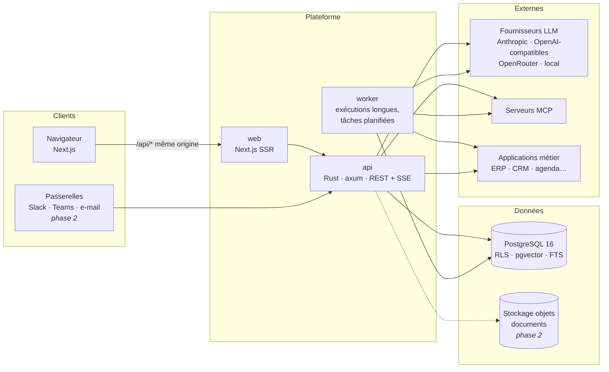
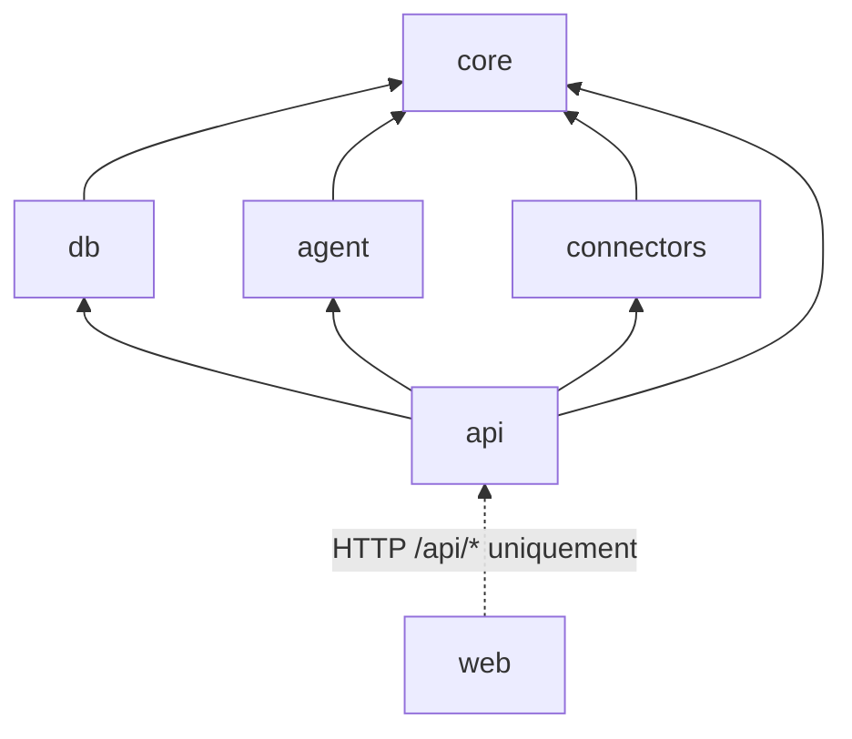

# Architecture technique

Statut : **référence vivante**. Toute évolution structurante est tracée dans
[DECISIONS.md](DECISIONS.md). Le statut d'implémentation de chaque brique est tenu dans
[ROADMAP.md](ROADMAP.md).

## 1. Vue d'ensemble

**Monolithe modulaire en Rust** (ADR-001, ADR-018), découpé en crates à frontières
nettes, avec une interface web Next.js ; déployé en trois processus issus du même dépôt :



- **web** : interface Next.js (App Router). Le navigateur ne parle qu'à l'origine web ;
  `/api/*` est relayé vers l'API (cookies `SameSite=Lax`, pas de CORS en production).
- **api** : authentification, API REST, flux temps réel SSE, exécution des tours de
  conversation, webhooks entrants.
- **worker** (phase 2) : exécutions longues (missions), reprises après interruption,
  tâches planifiées, ingestion de documents. En MVP, l'API exécute les runs en arrière-plan
  dans son propre processus et un balayage périodique marque en échec les runs restés
  sans progression ; le worker sera le même code lancé avec un autre point d'entrée.

Pourquoi pas des microservices : une équipe réduite, un domaine encore mouvant et des
transactions qui traversent plusieurs modules (autorisation + audit + exécution). Les
frontières de paquets permettent d'extraire un service plus tard si la charge l'exige.

## 2. Crates et dépendances

```
crates/                 Espace de travail Cargo (serveur)
  core/         Domaine pur : autorisation RBAC/ABAC, organigramme, autonomie,
                contrat d'outil, règles de mémoire, données de démo. Aucune E/S.
  db/           Migrations SQL (sqlx), RLS, transactions par entreprise, dépôts, seed
  agent/        Moteur agentique : fournisseurs LLM, boucle, PEP outils, budgets,
                vérification, outils mémoire et compétences
  connectors/   Contrat de connecteur, connecteur de démonstration, pont MCP (rmcp)
  api/          Serveur HTTP (axum) : sessions, routes, SSE, exécution des runs,
                binaires `mimorya-api` et `mimorya-seed`
apps/
  web/          Interface (Next.js, React, Tailwind) — seul paquet Node du dépôt
```

Règles de dépendance (imposées par les `Cargo.toml` : une dépendance non déclarée ne
compile pas) :



- `core` n'effectue aucune E/S (dépendances : `serde`, `schemars`, `validator`,
  `regex`, `chrono`, `uuid`).
- `agent` ne connaît pas la base : il dépend de **ports** (`RunStore`, `MemoryStore`,
  `AuditSink`, `ApprovalStore`… dans `runtime/ports.rs`) implémentés par `api` sur les
  dépôts de `db`. Le moteur est ainsi testable en mémoire, sans base ni réseau
  (`ScriptedProvider`, `InMemoryPorts`, fonctionnalité `testing`).
- `web` ne partage aucun code avec le serveur : il consomme le contrat JSON de l'API,
  décrit dans `apps/web/lib/api/types.ts`.

## 3. Pile technique retenue

| Domaine         | Choix                                                                                        | Justification                                                                                                                                                                       |
| --------------- | -------------------------------------------------------------------------------------------- | ----------------------------------------------------------------------------------------------------------------------------------------------------------------------------------- |
| Langage         | Rust (édition 2024) pour le serveur ; TypeScript (strict) pour l'interface                   | Sûreté mémoire, typage fort de bout en bout, performances et binaire unique à déployer (ADR-018). Python réservé à d'éventuels traitements spécialisés (OCR, ML) en service annexe. |
| Frontend        | Next.js 16, React 19, Tailwind CSS 4                                                         | Standard du marché, SSR, responsive, écosystème de composants accessible.                                                                                                           |
| API             | axum 0.8 + tokio                                                                             | Standard de l'écosystème Rust, middlewares composables, SSE natif (ADR-006, ADR-018).                                                                                               |
| Base            | PostgreSQL 16                                                                                | Transactions, JSONB, RLS pour l'isolation, FTS, extensions ; une seule base à opérer pour une PME (ADR-003).                                                                        |
| Vectoriel       | pgvector (HNSW, cosinus, 1024 dims) + FTS PostgreSQL                                         | Recherche hybride sans infrastructure supplémentaire (ADR-004).                                                                                                                     |
| Accès base      | sqlx 0.8 (requêtes SQL paramétrées) + migrations SQL versionnées                             | SQL explicite, compatible RLS (`set_config` transactionnel), migrations lisibles (ADR-008 remplacé par ADR-018).                                                                    |
| Validation      | serde + schemars + validator                                                                 | Une seule structure Rust donne le JSON Schema montré au modèle et la validation stricte des entrées (outils, API).                                                                  |
| Files d'attente | PostgreSQL (`FOR UPDATE SKIP LOCKED`, baux)                                                  | Pas de composant supplémentaire en MVP ; Redis/pg-boss évalués à la montée en charge (ADR-005, ADR-012).                                                                            |
| LLM             | Adaptateurs maison sur HTTP (`reqwest`) : Anthropic Messages (flux SSE) et OpenAI-compatible | Contrôle fin des appels d'outils, du cache, du coût et du routage ; OpenAI-compatible couvre OpenRouter, Gemini, Mistral, Ollama, vLLM (ADR-007).                                   |
| MCP             | `rmcp` (SDK Rust officiel, client)                                                           | SDK officiel ; transports stdio (privé) et Streamable HTTP (SaaS).                                                                                                                  |
| Mots de passe   | Argon2id (crate `argon2`, paramètres OWASP)                                                  | Recommandation OWASP ; SSO/OIDC en phase 2 (ADR-009).                                                                                                                               |
| Tests           | `cargo test` (unitaires) + tests d'intégration sur PostgreSQL réel (`cargo test-int`)        | Un seul outil, exécution en série des suites qui partagent la base de test.                                                                                                         |
| Observabilité   | Logs structurés (`tracing`), identifiant de requête ; OpenTelemetry en phase 3               | Exploitable tout de suite, standard ouvert ensuite.                                                                                                                                 |
| Conteneurs      | Docker + docker-compose (dev, déploiement privé simple)                                      | Reproductible ; Kubernetes seulement si nécessaire.                                                                                                                                 |

## 4. Flux principaux

### 4.1 Tour de conversation

```mermaid
sequenceDiagram
  participant U as Utilisateur
  participant A as API
  participant Z as Autorisation (core)
  participant E as Moteur agent
  participant L as LLM
  participant T as Outil / connecteur
  participant D as PostgreSQL
  U->>A: POST /conversations/:id/messages (cookie de session)
  A->>D: session → utilisateur, entreprise (SET LOCAL app.tenant_id)
  A->>Z: sujet (rôles, périmètres, attributs)
  A->>D: crée run (status=running) + message utilisateur
  A-->>U: 202 + run_id ; U s'abonne au flux SSE du run
  loop jusqu'à réponse finale ou budget épuisé
    E->>L: contexte (consignes fixes, contexte orga, mémoires autorisées, outils visibles)
    L-->>E: texte et/ou appels d'outils
    E->>Z: PEP : permissions requises + autonomie
    alt autorisé
      E->>T: exécute (périmètre de données lié au sujet)
      T-->>E: résultat (balisé « donnée non fiable »)
    else validation requise
      E->>D: crée approval, run → awaiting_approval
    else refusé
      E-->>L: refus motivé (le modèle s'adapte)
    end
    E->>D: événements, audit, usage
    E-->>U: événements SSE (étapes, outils, texte)
  end
  E->>E: vérification (ancrage des sources + critères), correction bornée
  E->>D: message final, mémoire proposée, statut
```

### 4.2 Mission longue et reprise

1. La mission crée un `agent_run` en statut `queued`.
2. Un worker le réserve (`FOR UPDATE SKIP LOCKED`, bail `lease_expires_at`).
3. Chaque étape est **persistée** (messages, événements, état) : en cas d'arrêt, un
   autre worker reprend au dernier point de contrôle une fois le bail expiré.
4. Une validation humaine met le run en `awaiting_approval` ; la décision le remet en
   file.
5. Les tâches récurrentes (phase 2) créent des runs selon une expression cron.

## 5. Moteur agentique et mémoire

Détaillés dans [AGENT_ENGINE.md](AGENT_ENGINE.md). En résumé :

- boucle **planifier → agir → observer → vérifier → corriger** bornée par des budgets
  (étapes, tokens, coût, durée) ;
- **PEP** (point d'application des politiques) sur chaque appel d'outil ;
- **sous-agents** avec plafond de permissions strictement inclus dans celui du parent ;
- mémoire à **quatre espaces** (personnel, unité, entreprise, expérience), recherche
  hybride FTS + vecteurs **pré-filtrée par les autorisations** ;
- **compétences** au format `SKILL.md` (compatible agentskills.io), versionnées,
  évaluées, activées après validation humaine, réversibles.

## 6. Connecteurs et outils

- Un **connecteur** déclare : ses permissions métier (ex. `intervention:read`), ses
  outils (structure d'entrée validée, niveau de risque, permissions requises), sa
  configuration et ses secrets.
- Une **instance de connecteur** est activée par entreprise, avec sa configuration, ses
  secrets chiffrés, sa table de correspondance permissions/risques et son journal.
- **MCP** : un pont transforme chaque outil d'un serveur MCP en outil de la plateforme.
  Les serveurs MCP ignorent tout de nos utilisateurs : l'administrateur **associe**
  chaque outil MCP à des permissions et à un niveau de risque (par défaut `write`,
  donc soumis à validation) ; les résultats sont traités comme non fiables.
- Les secrets ne transitent jamais par le contexte du modèle ni par les journaux.

Connecteurs prévus : démonstration (MVP), MCP générique (MVP), webhooks/REST générique,
e-mail (IMAP/SMTP, Microsoft Graph, Gmail), agendas, Slack/Teams/Telegram/Discord
(passerelles conversationnelles), Google Workspace / Microsoft 365, bases SQL en lecture,
GED, navigateur automatisé en bac à sable (phase 2+).

## 7. Isolation multi-entreprises

Défense en profondeur (détails : [SECURITY.md](SECURITY.md)) :

1. **Applicative** : chaque requête est exécutée dans une transaction qui positionne
   `app.tenant_id` ; les dépôts filtrent systématiquement par entreprise.
2. **Base** : **Row-Level Security** sur toutes les tables métier ; l'application se
   connecte avec un rôle **sans** `BYPASSRLS` et non propriétaire des tables. Sans
   `app.tenant_id`, aucune ligne n'est visible.
3. **Moteur** : `AuthorizationEngine.check` refuse toute ressource d'une autre
   entreprise avant toute autre règle.
4. **Tests** : suites d'intégration qui tentent des lectures croisées.

## 8. Temps réel

SSE (`text/event-stream`) pour suivre un run : simple, compatible proxys HTTP,
reprise via `Last-Event-ID` (événements numérotés en base). En MVP la diffusion est
en mémoire du processus ; avec plusieurs instances, elle passera par
`LISTEN/NOTIFY` PostgreSQL puis Redis si nécessaire.

## 9. Couche LLM

- Interface unique `LlmProvider.complete({system, messages, tools, …})` → texte, appels
  d'outils, usage (tokens, coût estimé).
- Adaptateurs : **Anthropic** (natif), **OpenAI-compatible** (OpenAI, OpenRouter,
  Gemini via point d'accès compatible, Mistral, Ollama, vLLM), **script** (tests
  déterministes).
- **Routage** par classe de tâche (`chat`, `planning`, `verification`, `summarize`,
  `embedding`) configurable par entreprise, avec contraintes de confidentialité
  (ex. « données confidentielles → modèle local uniquement », phase 2).
- Suivi des coûts : chaque appel enregistre fournisseur, modèle, tokens et coût estimé
  dans `usage_records`.

## 10. Observabilité et exploitation

- Logs structurés (`tracing`) avec `request_id` et `run_id` ; **jamais** d'en-têtes,
  de secrets, de mots de passe, de jetons ni de contenu de message.
- Journal d'audit métier séparé (table `audit_log`, en ajout seul).
- Événements de run persistés : rejouables pour le support et l'analyse.
- Phase 3 : OpenTelemetry (traces), métriques Prometheus, tableaux de bord
  d'exploitation, alertes de coût.

## 11. Déploiement

| Mode          | Description                                                                                             |
| ------------- | ------------------------------------------------------------------------------------------------------- |
| Développement | `docker compose up db` + `cargo run --bin mimorya-api` / `pnpm dev:web`                                 |
| Privé (PME)   | `docker compose` : web, api (worker embarqué), PostgreSQL ; sauvegardes `pg_dump`/WAL                   |
| SaaS          | Images web/api/worker séparées, PostgreSQL managé, montée en charge horizontale de l'API et des workers |

Configuration exclusivement par variables d'environnement (voir `.env.example`).
Les secrets d'infrastructure (clé maître de chiffrement, clés LLM) viennent de
l'environnement ou d'un gestionnaire de secrets ; ceux des entreprises sont stockés
chiffrés en base.

## 12. Analyse de Hermes Agent (Nous Research)

Analyse réalisée sur le dépôt `NousResearch/hermes-agent` (commit `bb834a2`, v0.22.x).

**Constat** : licence **MIT** (Copyright 2025 Nous Research) — réutilisation commerciale
permise avec mention. Projet Python d'environ 1 M de lignes hors tests, état sur disque
(fichiers + SQLite), conçu explicitement comme **agent personnel mono-utilisateur**
(« Hermes Agent is a single-tenant personal agent » — SECURITY.md du projet) : ni
entreprise, ni utilisateurs, ni RBAC ; la frontière de sécurité revendiquée est le
système d'exploitation. Certains éléments du catalogue de plugins sont sous GPL/AGPL
(à exclure).

| Mécanisme Hermes                                                                                            | Décision                     | Adaptation                                                                                                              |
| ----------------------------------------------------------------------------------------------------------- | ---------------------------- | ----------------------------------------------------------------------------------------------------------------------- |
| Boucle agentique (`run_conversation`, budgets d'itérations, classification d'erreurs, repli de fournisseur) | **Concept repris**           | Réimplémentée en Rust, avec PEP, budgets de coût, persistance et reprise.                                               |
| Compression de contexte (élagage des sorties d'outils, protection tête/queue, résumé par modèle auxiliaire) | **Concept repris**           | Phase 2 ; prompt système stable pour le cache fournisseur.                                                              |
| Mémoire `MEMORY.md` / `USER.md` bornée, chargée en début de session                                         | **Concept repris**           | Devient la mémoire personnelle bornée ; plus espaces d'équipe/entreprise/expérience, en base, filtrés par autorisation. |
| Recherche dans les sessions passées (SQLite FTS5)                                                           | **Concept repris**           | FTS PostgreSQL + pgvector, filtrée par utilisateur.                                                                     |
| Skills `SKILL.md` + chargement progressif (liste → contenu → références)                                    | **Format adopté**            | Compatibilité agentskills.io, extensions sous `metadata.mimorya.*`, versions en base, évaluations, validation humaine.  |
| Création/patch autonome de skills, revue post-tour, « curator » qui archive                                 | **Concept repris, encadré**  | Propositions en statut `draft`/`candidate`, jamais actives sans validation ; aucune skill ne porte de permission.       |
| Délégation (`delegate_task`, outils interdits aux enfants, profondeur 1, parallélisme borné)                | **Concept repris**           | Sous-agents en runs enfants persistés, plafond de permissions ⊆ parent.                                                 |
| Registre d'outils, toolsets, approbation des commandes dangereuses                                          | **Concept repris**           | Contrat d'outil typé avec niveau de risque ; approbations liées aux niveaux d'autonomie ; pas de shell libre.           |
| Client MCP (stdio, HTTP, OAuth)                                                                             | **Concept repris**           | SDK MCP Rust officiel (`rmcp`) ; association permissions/risques par l'administrateur.                                  |
| Passerelles (Telegram, Discord, Slack, e-mail…) et clé de session par plateforme                            | **Concept repris** (phase 2) | Identité de canal **liée à un compte utilisateur** ; permissions identiques à celles du web.                            |
| Cron (`jobs.json`, tick 60 s)                                                                               | **Concept repris** (phase 2) | Tâches en base, exécutées par les workers, appartenant à un utilisateur.                                                |
| Abstraction fournisseurs (format OpenAI interne, Anthropic natif, OpenRouter)                               | **Concept repris**           | Même approche : adaptateur natif Anthropic + OpenAI-compatible.                                                         |
| Code Python, stockage fichiers/SQLite, état global de processus                                             | **Non réutilisé**            | Incompatible avec le multi-entreprises, l'isolation et le passage à l'échelle.                                          |

**Option écartée** : exécuter une instance Hermes par entreprise derrière son API
compatible OpenAI. Cela réutiliserait le code mais au prix d'une isolation par
conteneur coûteuse, d'une mémoire partagée entre utilisateurs d'une même instance et
d'aucun contrôle fin des permissions — incompatible avec les exigences de ce produit.
Le contenu des skills MIT/Apache d'Hermes pourra être importé (avec attribution) une
fois le format compatible en place.

## 13. Contraintes et risques majeurs

| Risque                                                                         | Impact   | Mesures                                                                                           |
| ------------------------------------------------------------------------------ | -------- | ------------------------------------------------------------------------------------------------- |
| Fuite de données entre entreprises                                             | Critique | RLS + filtrage applicatif + tests d'isolation systématiques ; rôle base sans `BYPASSRLS`.         |
| Fuite entre utilisateurs d'une même entreprise (via mémoire, recherche, agent) | Critique | Pré-filtrage des recherches par périmètre, mémoire personnelle non partagée, plafond agent.       |
| Injection de prompt (documents, e-mails, résultats d'outils)                   | Élevé    | Autorisations hors modèle, données balisées non fiables, validations, permissions non délégables. |
| Actions erronées à impact externe                                              | Élevé    | Niveaux d'autonomie, validations, risques déclarés par outil, journal d'audit.                    |
| Hallucinations dans les synthèses                                              | Élevé    | Vérification d'ancrage (identifiants cités ∈ sources), critères de réussite, sources affichées.   |
| Dérive des coûts LLM                                                           | Moyen    | Budgets par run, quotas par entreprise, routage vers modèles économiques, suivi d'usage.          |
| Dépendance à un fournisseur LLM                                                | Moyen    | Abstraction fournisseurs, routage configurable, support des modèles locaux.                       |
| Régression d'une compétence auto-améliorée                                     | Moyen    | Versions, évaluations, non-régression, retour arrière, validation humaine.                        |
| Conformité RGPD (sous-traitants LLM hors UE, conservation)                     | Élevé    | Choix de fournisseurs/régions par entreprise, minimisation, rétention, export/suppression, DPA.   |
| Complexité excessive trop tôt                                                  | Moyen    | Monolithe modulaire, PostgreSQL seul en MVP, phases strictes.                                     |
| Qualité variable des modèles pour l'appel d'outils                             | Moyen    | Tests de scénario par modèle, sélection de modèles validés, schémas d'outils simples.             |
