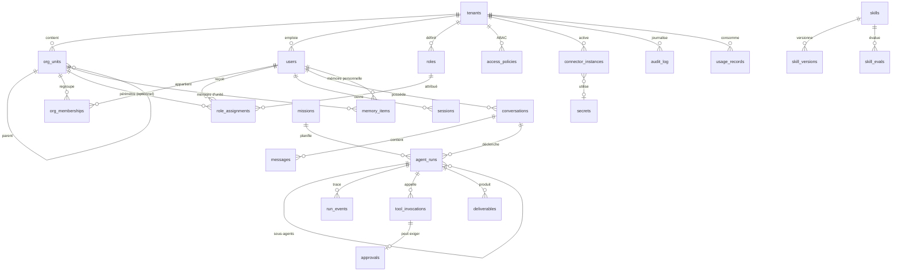

# Modèle de données

Source de vérité : les migrations SQL de `crates/db/migrations/` (appliquées par
`sqlx`, ADR-018). Les dépôts de `crates/db/src/repositories/` en sont l'accès typé.
Ce document en donne la lecture métier.

## 1. Conventions

- Clés primaires `uuid` (`gen_random_uuid()`), sauf journaux à fort volume (`bigserial`).
- **Toute table métier porte `tenant_id`** et est protégée par une politique RLS
  `tenant_isolation` (voir §4). Exceptions : aucune en MVP (même `tenants` est filtrée).
- Horodatages `timestamptz` en UTC : `created_at`, `updated_at`.
- Énumérations stockées en `text` + contrainte `CHECK` (évolutives sans migration de type).
- Les secrets ne sont jamais stockés en clair (table `secrets`, AES-256-GCM).
- Suppression : physique pour les données personnelles (droit à l'effacement), la trace
  de la suppression restant dans l'audit **sans le contenu**.

## 2. Vue d'ensemble

## 3. Entités

### 3.1 Organisation et identité

| Table             | Rôle                                | Champs clés                                                                                                                                                                                                                                              |
| ----------------- | ----------------------------------- | -------------------------------------------------------------------------------------------------------------------------------------------------------------------------------------------------------------------------------------------------------- |
| `tenants`         | Entreprise cliente                  | `slug` unique, `name`, `status` (`active`/`suspended`), `settings` (autonomie par défaut, routage LLM, rétention)                                                                                                                                        |
| `org_units`       | Organigramme à profondeur illimitée | `parent_id` (auto-référence), `type` (`company`, `site`, `direction`, `department`, `service`, `team`), `lead_user_id` (**informatif, n'accorde aucun droit**)                                                                                           |
| `users`           | Compte personnel                    | `email` (citext, unique global), `display_name`, `job_title`, `status`, `password_hash` (argon2id, nul si SSO), `must_change_password` (mot de passe provisoire à remplacer), `clearance` (niveau de sensibilité maximal), `attributes` (ABAC), `locale` |
| `org_memberships` | Rattachement personne ↔ unité       | `is_primary` (une seule unité principale par personne)                                                                                                                                                                                                   |
| `sessions`        | Sessions web                        | `token_hash` (SHA-256 du jeton opaque), `expires_at`, `revoked_at`, `ip`, `user_agent`                                                                                                                                                                   |

MVP : un compte appartient à **une** entreprise. Une identité multi-entreprises
(consultant, groupe) passera par une table `identities` en phase 3.

### 3.2 Autorisations

| Table              | Rôle                        | Champs clés                                                                                                                                                                       |
| ------------------ | --------------------------- | --------------------------------------------------------------------------------------------------------------------------------------------------------------------------------- |
| `roles`            | Ensemble de permissions     | `key` unique par entreprise, `permissions text[]` (motifs `domaine:action`, `domaine:*` ; rôles personnalisés : clé `custom_…`, permissions du catalogue sans joker), `is_system` |
| `role_assignments` | Rôle × personne × périmètre | `scope_type` (`tenant`, `org_unit`, `self`), `scope_org_unit_id`, `include_descendants`, `expires_at`, `granted_by_user_id`                                                       |
| `access_policies`  | Règles ABAC                 | `effect` (`allow`/`deny`), `permissions text[]`, `condition jsonb` (langage de conditions de `core`), `enabled`                                                                   |

### 3.3 Conversations, missions et exécutions

| Table              | Rôle                                                      | Champs clés                                                                                                                                                                                                                                                                                                                                              |
| ------------------ | --------------------------------------------------------- | -------------------------------------------------------------------------------------------------------------------------------------------------------------------------------------------------------------------------------------------------------------------------------------------------------------------------------------------------------- |
| `conversations`    | Fil de discussion                                         | `owner_user_id`, `visibility` (`private`, `org_unit`), `org_unit_id`                                                                                                                                                                                                                                                                                     |
| `messages`         | Messages utilisateur / agent                              | `role`, `author_user_id`, `content`, `run_id`, `metadata` (citations, pièces jointes), `content_tsv` (FTS « recherche dans les échanges passés »)                                                                                                                                                                                                        |
| `missions`         | Travail suivi dans la durée                               | `owner_user_id`, `status`, `success_criteria`, `autonomy_level`, `schedule_cron` / `next_run_at` (phase 2)                                                                                                                                                                                                                                               |
| `agent_runs`       | Une exécution de l'agent                                  | `on_behalf_of_user_id` (**dont les permissions s'appliquent**), `initiated_by_user_id`, `parent_run_id` (sous-agent), `agent_profile`, `status`, `objective`, `success_criteria`, `plan`, `autonomy_level`, `allowed_permissions` (plafond), `budget`, `usage`, `state` (point de reprise), `result`, `verification`, `lease_owner` / `lease_expires_at` |
| `run_events`       | Journal d'exécution rejouable                             | `seq` (ordre, sert de `Last-Event-ID` SSE), `type`, `data`                                                                                                                                                                                                                                                                                               |
| `tool_invocations` | Chaque appel d'outil                                      | `tool_name`, `input` (expurgé), `decision`, `decision_reason`, `status`, `output_summary`, `duration_ms`                                                                                                                                                                                                                                                 |
| `approvals`        | Validations humaines                                      | `tool_name`, `action_summary`, `payload`, `risk`, `status` (`pending`, `approved`, `rejected`, `expired`, `cancelled`), `decided_by_user_id`, `expires_at`                                                                                                                                                                                               |
| `deliverables`     | Livrables produits (synthèse, planning proposé, document) | `type`, `title`, `content jsonb`, `status` (`draft`, `approved`, `applied`, `discarded`), `owner_user_id`, `org_unit_id`                                                                                                                                                                                                                                 |

Statuts d'un run : `queued → running → (awaiting_approval ↔ running) → completed | failed | cancelled`.

### 3.4 Mémoire et compétences

| Table            | Rôle                              | Champs clés                                                                                                                                                                                                                                                                                                                                                                                                                                            |
| ---------------- | --------------------------------- | ------------------------------------------------------------------------------------------------------------------------------------------------------------------------------------------------------------------------------------------------------------------------------------------------------------------------------------------------------------------------------------------------------------------------------------------------------ |
| `memory_items`   | Unité de mémoire                  | `scope` (`user`, `org_unit`, `tenant`, `experience`), `owner_user_id`, `org_unit_id`, `kind` (`preference`, `fact`, `procedure`, `decision`, `lesson`, `episode`), `title`, `content`, `sensitivity`, `status` (`active`, `proposed`, `archived`), `source` (traçabilité : conversation, run, document, saisie), `confidence`, `expires_at` (rétention), `last_used_at`, `use_count`, `content_tsv` (FTS), `embedding vector(1024)`, `embedding_model` |
| `skills`         | Compétence réutilisable           | `name` (slug, unique par entreprise), `description`, `status`, `active_version_id`, `scope`, `org_unit_id`                                                                                                                                                                                                                                                                                                                                             |
| `skill_versions` | Version immuable d'une compétence | `version`, `content` (corps `SKILL.md`), `frontmatter`, `changelog`, `status` (`draft`, `candidate`, `active`, `rejected`, `retired`), `created_by_run_id`, `approved_by_user_id`, `eval_summary`                                                                                                                                                                                                                                                      |
| `skill_evals`    | Cas d'évaluation (non-régression) | `input`, `success_criteria`                                                                                                                                                                                                                                                                                                                                                                                                                            |

Index : GIN sur `content_tsv`, HNSW (`vector_cosine_ops`) sur `embedding`,
index composites par `(tenant_id, scope, owner_user_id)` et `(tenant_id, org_unit_id)`.

Phase 2 : `skill_eval_runs`, `documents` / `document_chunks` (GED, ingestion),
`schedules`, `channel_identities` (Slack, Teams… ↔ utilisateur).

### 3.5 Connecteurs, secrets, audit, consommation

| Table                 | Rôle                                  | Champs clés                                                                                                                                                                                                                 |
| --------------------- | ------------------------------------- | --------------------------------------------------------------------------------------------------------------------------------------------------------------------------------------------------------------------------- |
| `connector_instances` | Connecteur activé pour une entreprise | `type` (`demo_interventions`, `mcp`…), `name`, `enabled`, `config` (sans secret), `tool_policies` (outil → permissions, risque, activé), `secret_id`, `status`, `last_error`                                                |
| `secrets`             | Secrets chiffrés                      | `name`, `ciphertext`, `iv`, `auth_tag`, `key_version` — jamais renvoyés par l'API                                                                                                                                           |
| `audit_log`           | Journal d'audit en ajout seul         | `actor_type` (`user`, `agent`, `system`), `actor_user_id`, `on_behalf_of_user_id`, `run_id`, `action`, `resource_type`, `resource_id`, `outcome` (`success`, `denied`, `failure`), `reason`, `metadata`, `ip`, `request_id` |
| `usage_records`       | Consommation                          | `kind` (`llm`, `embedding`, `tool`), `provider`, `model`, `input_tokens`, `output_tokens`, `cost_micros`, `user_id`, `run_id`                                                                                               |

## 4. Isolation et rôles PostgreSQL

- Rôle **propriétaire** (`DATABASE_URL`) : exécute les migrations et le seed.
- Rôle **applicatif** `mimorya_app` (`DATABASE_APP_URL`) : `NOSUPERUSER NOBYPASSRLS`,
  non propriétaire ; droits DML sur les tables, avec ces restrictions :
  - `audit_log` : **`INSERT`/`SELECT` seulement** ;
  - `tenants`, `users`, `conversations`, `agent_runs` : **pas de `DELETE`**. Leur
    suppression effacerait ou réécrirait des entrées d'audit par les clés étrangères
    (`ON DELETE cascade` / `set null`) ; elle est réservée au rôle propriétaire, qui
    devra conserver la trace (procédures d'effacement et purges de rétention à venir) ;
  - `_sqlx_migrations` (journal des migrations) : aucun droit.
- Chaque table : `ENABLE ROW LEVEL SECURITY` + politique
  `tenant_id = current_setting('app.tenant_id', true)::uuid` (lecture **et** écriture).
- Le contexte est posé par transaction : `SELECT set_config('app.tenant_id', $1, true)`.
- Des fonctions `SECURITY DEFINER` minimales (chemin de recherche figé) couvrent les
  seuls besoins qui traversent les entreprises : `auth_find_login` (retrouver un compte
  par e-mail à la connexion), `auth_resolve_session` (résoudre une session par
  l'empreinte de son jeton, avec l'obligation éventuelle de changer de mot de passe) et `system_fail_stale_runs` (marquer en échec les runs
  restés sans progression).

## 5. Rétention (valeurs par défaut, configurables par entreprise)

| Donnée                        | Durée par défaut                                                              |
| ----------------------------- | ----------------------------------------------------------------------------- |
| Messages et événements de run | 24 mois                                                                       |
| Mémoire personnelle           | Jusqu'à suppression par l'utilisateur ou départ (compte désactivé + 30 jours) |
| Mémoire `episode`             | 12 mois                                                                       |
| Journal d'audit               | 5 ans (conformité), sans contenu de message                                   |
| Sessions expirées             | 30 jours                                                                      |
| Consommation                  | 5 ans (facturation)                                                           |
