# Modèle de données

Source de vérité : les migrations SQL de `crates/db/migrations/` (appliquées par
`sqlx`, ADR-018). Les dépôts de `crates/db/src/repositories/` en sont l'accès typé.
Ce document en donne la lecture métier.

## 1. Conventions

- Clés primaires `uuid` (`gen_random_uuid()`), sauf journaux à fort volume (`bigserial`).
- **Toute table métier porte `tenant_id`** et est protégée par une politique RLS
  `tenant_isolation` (voir §4). Exceptions : aucune en MVP (même `tenants` est filtrée).
- Horodatages `timestamptz` en UTC : `created_at`, `updated_at`.
- Énumérations stockées en `text` + contrainte `CHECK` (évolutives sans migration de type).
- Les secrets ne sont jamais stockés en clair (table `secrets`, AES-256-GCM).
- Suppression : physique pour les données personnelles (droit à l'effacement), la trace
  de la suppression restant dans l'audit **sans le contenu**.

## 2. Vue d'ensemble

```mermaid
erDiagram
  tenants ||--o{ org_units : contient
  tenants ||--o{ users : emploie
  org_units ||--o{ org_units : parent
  users ||--o{ org_memberships : appartient
  org_units ||--o{ org_memberships : regroupe
  tenants ||--o{ roles : définit
  users ||--o{ role_assignments : reçoit
  roles ||--o{ role_assignments : attribué
  org_units ||--o{ role_assignments : "périmètre (optionnel)"
  tenants ||--o{ access_policies : "ABAC"
  users ||--o{ sessions : ouvre
  users ||--o| user_invitations : invite
  users ||--o| password_resets : réinitialise
  users ||--o| approval_delegations : "absent, se fait remplacer"
  users ||--o{ scheduled_tasks : "demande à heure fixe"
  tenants ||--o{ identity_providers : "se connecte par"
  identity_providers ||--o{ identity_provider_domains : couvre
  identity_providers ||--o{ user_identities : relie
  identity_providers ||--o{ sso_used_assertions : "a reçu"
  tenants ||--o{ verified_domains : "a prouvé"
  users ||--o{ user_identities : "identité chez"
  users ||--o{ conversations : possède
  conversations ||--o{ messages : contient
  conversations ||--o{ agent_runs : déclenche
  missions ||--o{ agent_runs : planifie
  agent_runs ||--o{ agent_runs : "sous-agents"
  agent_runs ||--o{ run_events : trace
  agent_runs ||--o{ tool_invocations : appelle
  tool_invocations ||--o| approvals : "peut exiger"
  agent_runs ||--o{ deliverables : produit
  users ||--o{ memory_items : "mémoire personnelle"
  org_units ||--o{ memory_items : "mémoire d'unité"
  skills ||--o{ skill_versions : versionne
  skills ||--o{ skill_eval_cases : évalue
  skills ||--o{ skill_evaluations : éprouve
  skill_evaluations ||--o{ skill_evaluation_results : juge
  tenants ||--o{ connector_instances : active
  connector_instances }o--o| secrets : utilise
  tenants ||--o{ audit_log : journalise
  tenants ||--o{ usage_records : consomme
```

## 3. Entités

### 3.1 Organisation et identité

| Table                       | Rôle                                                                                 | Champs clés                                                                                                                                                                                                                                                                                                                                                                                                                                                                                                                                                                                                                                                                                                                                                            |
| --------------------------- | ------------------------------------------------------------------------------------ | ---------------------------------------------------------------------------------------------------------------------------------------------------------------------------------------------------------------------------------------------------------------------------------------------------------------------------------------------------------------------------------------------------------------------------------------------------------------------------------------------------------------------------------------------------------------------------------------------------------------------------------------------------------------------------------------------------------------------------------------------------------------------- |
| `tenants`                   | Entreprise cliente                                                                   | `slug` unique, `name`, `status` (`active`/`suspended`), `settings` (autonomie par défaut, routage LLM, rétention)                                                                                                                                                                                                                                                                                                                                                                                                                                                                                                                                                                                                                                                      |
| `org_units`                 | Organigramme à profondeur illimitée                                                  | `parent_id` (auto-référence), `type` (`company`, `site`, `direction`, `department`, `service`, `team`), `lead_user_id` (**informatif, n'accorde aucun droit**)                                                                                                                                                                                                                                                                                                                                                                                                                                                                                                                                                                                                         |
| `users`                     | Compte personnel                                                                     | `email` (citext, unique global), `display_name`, `job_title`, `status` (`invited` tant que le compte n'a pas choisi son mot de passe ni accepté son invitation par le fournisseur d'identité, ADR-064, `active`, `disabled`), `password_hash` (argon2id, nul pour un compte invité ou SSO), `must_change_password` (mot de passe provisoire à remplacer), `activated` (le compte a été actif : invitation acceptée, ou mot de passe provisoire reçu, à la création ou de l'administration ; réactivé, un compte qui ne l'a jamais été redevient `invited`, ADR-064), `clearance` (niveau de sensibilité maximal), `attributes` (ABAC : objet de 20 entrées au plus, valeurs texte, nombre, oui/non ou liste de textes, posées par l'administration, ADR-023), `locale` |
| `org_memberships`           | Rattachement personne ↔ unité                                                        | `is_primary` (une seule unité principale par personne)                                                                                                                                                                                                                                                                                                                                                                                                                                                                                                                                                                                                                                                                                                                 |
| `sessions`                  | Sessions web                                                                         | `token_hash` (SHA-256 du jeton opaque), `expires_at`, `revoked_at`, `ip`, `user_agent`                                                                                                                                                                                                                                                                                                                                                                                                                                                                                                                                                                                                                                                                                 |
| `user_invitations`          | Lien d'invitation d'un compte (ADR-027)                                              | `user_id` (unique : une invitation en cours au plus), `token_hash` (SHA-256 du jeton du lien), `created_by_user_id` (nul si l'exploitant l'a émise, ADR-033), `expires_at` (7 jours) ; supprimée à l'acceptation, au renvoi (remplacée) ou à la désactivation du compte                                                                                                                                                                                                                                                                                                                                                                                                                                                                                                |
| `identity_providers`        | Fournisseur d'identité de l'entreprise (SSO OpenID Connect, ADR-063 ; SAML, ADR-068) | `kind` (`microsoft`, `google`, `oidc`, `saml`), `name` (bouton de la page de connexion), `issuer` et `client_id` (fixés à la déclaration, uniques ensemble dans l'entreprise), `enabled`, `required` (obligatoire pour ses domaines : mot de passe refusé à leurs comptes, sauf aux administrateurs de la connexion, ADR-066), `create_accounts` (crée à la première connexion par le lien de l'entreprise le compte d'une personne de ses domaines, ADR-067), `saml_metadata` (SAML seulement : métadonnées déclarées ; l'émetteur est leur identifiant d'entité, le client celui de l'entreprise auprès du fournisseur) ; le secret client (OpenID Connect) est dans `secrets` (`sso.{id}.client_secret`)                                                            |
| `identity_provider_domains` | Domaines d'e-mail couverts par un fournisseur                                        | `domain` (citext ; un fournisseur par domaine dans l'entreprise, une autre entreprise peut déclarer le même pour ses comptes), `provider_id` (même entreprise, clé composite)                                                                                                                                                                                                                                                                                                                                                                                                                                                                                                                                                                                          |
| `user_identities`           | Identité d'un compte chez un fournisseur                                             | `provider_id` (même entreprise, clé composite), `user_id`, `subject` (sujet immuable : `oid` pour Microsoft, `sub` sinon ; unique par fournisseur), une seule par compte et par fournisseur, `last_used_at` ; supprimée avec le fournisseur ou le compte                                                                                                                                                                                                                                                                                                                                                                                                                                                                                                               |
| `sso_used_assertions`       | Assertions SAML déjà reçues (ADR-068)                                                | `provider_id` (même entreprise), `assertion_id` (unique par fournisseur), `expires_at` : gardée jusqu'à son expiration pour refuser un rejeu, puis purgée ; pas de donnée personnelle                                                                                                                                                                                                                                                                                                                                                                                                                                                                                                                                                                                  |
| `verified_domains`          | Domaines d'e-mail prouvés par l'entreprise (ADR-069)                                 | `domain` (unique par entreprise), `verified_at` (dernière lecture de son enregistrement DNS), `verified_by_user_id` (qui l'a demandée, mis à `NULL` à la suppression du compte) ; gardée avec l'entreprise ; un fournisseur générique ou SAML ne crée de compte que dans ces domaines                                                                                                                                                                                                                                                                                                                                                                                                                                                                                  |
| `password_resets`           | Lien de réinitialisation du mot de passe (ADR-028)                                   | `user_id` (unique : un lien en cours au plus), `token_hash` (SHA-256 du jeton du lien), `expires_at` (1 heure ; 24 heures s'il est envoyé par un administrateur, ADR-029) ; supprimé à l'usage, à une nouvelle demande ou un envoi par un administrateur (remplacé), si son envoi par un administrateur échoue, à tout changement du mot de passe ou du statut du compte (déclencheur sur `users`) et, expiré, par la maintenance périodique                                                                                                                                                                                                                                                                                                                           |

MVP : un compte appartient à **une** entreprise. Une identité multi-entreprises
(consultant, groupe) passera par une table `identities` en phase 3.

### 3.2 Autorisations

| Table              | Rôle                        | Champs clés                                                                                                                                                                                            |
| ------------------ | --------------------------- | ------------------------------------------------------------------------------------------------------------------------------------------------------------------------------------------------------ |
| `roles`            | Ensemble de permissions     | `key` unique par entreprise, `permissions text[]` (motifs `domaine:action`, `domaine:*` ; rôles personnalisés : clé `custom_…`, permissions du catalogue sans joker), `is_system`                      |
| `role_assignments` | Rôle × personne × périmètre | `scope_type` (`tenant`, `org_unit`, `self`), `scope_org_unit_id`, `include_descendants`, `expires_at`, `granted_by_user_id`                                                                            |
| `access_policies`  | Règles ABAC                 | `effect` (`allow`/`deny`), `permissions text[]`, `condition jsonb` (langage de conditions de `core`, vérifié avant écriture), `enabled` ; l'administration n'écrit que des politiques `deny` (ADR-022) |

### 3.3 Conversations, missions et exécutions

| Table                  | Rôle                                                      | Champs clés                                                                                                                                                                                                                                                                                                                                                                                                                                                                                                                                                                                                                                                                                                                                                                                                                                                                                                                                                                                                                                                                                                                                                                                                                                                                                              |
| ---------------------- | --------------------------------------------------------- | -------------------------------------------------------------------------------------------------------------------------------------------------------------------------------------------------------------------------------------------------------------------------------------------------------------------------------------------------------------------------------------------------------------------------------------------------------------------------------------------------------------------------------------------------------------------------------------------------------------------------------------------------------------------------------------------------------------------------------------------------------------------------------------------------------------------------------------------------------------------------------------------------------------------------------------------------------------------------------------------------------------------------------------------------------------------------------------------------------------------------------------------------------------------------------------------------------------------------------------------------------------------------------------------------------- |
| `conversations`        | Fil de discussion                                         | `owner_user_id`, `visibility` (`private`, `org_unit`), `org_unit_id`                                                                                                                                                                                                                                                                                                                                                                                                                                                                                                                                                                                                                                                                                                                                                                                                                                                                                                                                                                                                                                                                                                                                                                                                                                     |
| `messages`             | Messages utilisateur / agent                              | `role`, `author_user_id`, `content`, `run_id`, `metadata` (citations, pièces jointes), `content_tsv` (FTS « recherche dans les échanges passés »)                                                                                                                                                                                                                                                                                                                                                                                                                                                                                                                                                                                                                                                                                                                                                                                                                                                                                                                                                                                                                                                                                                                                                        |
| `missions`             | Missions longues (ADR-089)                                | `owner_user_id` (au nom de qui elle agit), `conversation_id` (sa conversation, une par mission, où ses étapes répondent), `title`, `description` (son objectif, celui de chaque étape), `success_criteria` (1 à 8, au regard desquels sa réponse finale est revue), `autonomy_level`, `status` (`in_progress`, puis `done`, `failed` ou `cancelled` à sa fin ; en cours, lu sur sa dernière étape), `limits` (étapes et coût, tels qu'à sa création), `stages` (étapes commencées), `evidence` (sources trouvées par ses étapes, les 200 dernières), `result`, `verification`, `error`, `finished_at`, `end_notified_at` (quand son auteur a été prévenu de sa fin, ou que le relais a refusé le message, ADR-091) ; trois en cours au plus par personne ; `schedule_cron` / `next_run_at` inutilisés                                                                                                                                                                                                                                                                                                                                                                                                                                                                                                    |
| `agent_runs`           | Une exécution de l'agent                                  | `on_behalf_of_user_id` (**dont les permissions s'appliquent**), `initiated_by_user_id`, `parent_run_id` (le run qui a confié sa tâche à ce sous-agent, ADR-098), `agent_profile` (`main`, ou le profil du sous-agent : `research`, `analysis`, `planning`, `quality`), `status` (`queued` : en file d'attente pour un worker, ADR-085 ; `running`, `awaiting_approval`, `completed`, `failed`, `cancelled`), `objective`, `success_criteria`, `plan`, `autonomy_level`, `allowed_permissions` (plafond), `budget`, `usage`, `state` (point de reprise), `result`, `verification`, `lease_owner` / `lease_expires_at` (exécuteur qui le tient et échéance de son bail, effacés dès qu'il quitte `running`, ADR-083 ; chaque écriture de l'exécuteur verrouille le run tant qu'il porte son bail, ADR-086), `taken_up_at` (sa dernière reprise par un autre exécuteur : le balayage des runs bloqués en compte, pas l'heure maximale d'interruption, ADR-086), `request_message_id` (la demande d'un tour de conversation, qu'un worker lui donne après les messages précédents, ADR-085), `mission_id` (la mission dont il est une étape, ADR-089). Un sous-agent n'a ni conversation, ni mission, ni bail : il s'exécute sous celui de son parent, n'est jamais repris seul et échoue avec lui (ADR-098) |
| `run_events`           | Journal d'exécution rejouable                             | `seq` (ordre, sert de `Last-Event-ID` SSE), `type` (dont `run_queued` : en file pour un worker, ADR-085), `data`                                                                                                                                                                                                                                                                                                                                                                                                                                                                                                                                                                                                                                                                                                                                                                                                                                                                                                                                                                                                                                                                                                                                                                                         |
| `tool_invocations`     | Chaque appel d'outil                                      | `tool_name`, `input` (expurgé), `decision`, `decision_reason`, `status`, `output_summary`, `duration_ms`                                                                                                                                                                                                                                                                                                                                                                                                                                                                                                                                                                                                                                                                                                                                                                                                                                                                                                                                                                                                                                                                                                                                                                                                 |
| `approvals`            | Validations humaines                                      | `requested_for_user_id` (pour qui l'agent agit), `tool_name`, `action_summary`, `payload`, `risk`, `status` (`pending`, `approved`, `rejected`, `expired`, `cancelled`), `routing` (`requester` ou `manager`) et `approver_user_id` (le responsable désigné, ADR-059), `decided_by_user_id`, `expires_at` (7 jours ; passée, la demande expire, ADR-061)                                                                                                                                                                                                                                                                                                                                                                                                                                                                                                                                                                                                                                                                                                                                                                                                                                                                                                                                                 |
| `approval_delegations` | Absences déclarées (ADR-071)                              | `user_id` (l'absent, une absence au plus), `delegate_user_id` (son remplaçant, jamais lui-même), `starts_at`, `ends_at` (au plus 90 jours après le début), `declared_by_user_id` (l'administrateur des comptes qui l'a déclarée pour l'absent, ADR-078 ; nul si l'absent l'a déclarée lui-même) ; aucun droit accordé : le remplaçant décide les demandes en attente de l'absent sur lesquelles il détient lui-même `approval:decide` ; supprimée avec le compte de l'un ou de l'autre, au retrait et, terminée, par la maintenance périodique                                                                                                                                                                                                                                                                                                                                                                                                                                                                                                                                                                                                                                                                                                                                                           |
| `scheduled_tasks`      | Tâches planifiées (ADR-080)                               | `user_id` (l'auteur, au nom de qui elles agissent), `title`, `instruction` (envoyée comme la sienne), `weekdays` (1 = lundi), `time_of_day` (`HH:MM`), `time_zone`, `next_run_at` (nul : en pause), dernière occurrence (`last_run_at`, `last_outcome`, `last_problem`), conversation et run de la dernière lancée (`last_conversation_id`, `last_run_id` : aucune ne part tant que ce run n'est pas fini) ; vingt au plus par personne ; supprimées par leur auteur ou avec son compte                                                                                                                                                                                                                                                                                                                                                                                                                                                                                                                                                                                                                                                                                                                                                                                                                  |
| `deliverables`         | Livrables produits (synthèse, planning proposé, document) | `type`, `title`, `content jsonb`, `status` (`draft`, `approved`, `applied`, `discarded`), `owner_user_id`, `org_unit_id`                                                                                                                                                                                                                                                                                                                                                                                                                                                                                                                                                                                                                                                                                                                                                                                                                                                                                                                                                                                                                                                                                                                                                                                 |

Statuts d'un run : `running` dès sa création (ou `queued` quand un processus `api` le crée,
puis `running` quand un worker le réserve) → (`awaiting_approval` → `running`, ou `queued`
quand la décision est prise dans un processus `api`) → `completed` | `failed` |
`cancelled`. Un run resté plus d'une heure en file passe en `failed` sans être exécuté
(ADR-085).

### 3.4 Mémoire et compétences

| Table                      | Rôle                                        | Champs clés                                                                                                                                                                                                                                                                                                                                                                                                                                            |
| -------------------------- | ------------------------------------------- | ------------------------------------------------------------------------------------------------------------------------------------------------------------------------------------------------------------------------------------------------------------------------------------------------------------------------------------------------------------------------------------------------------------------------------------------------------ |
| `memory_items`             | Unité de mémoire                            | `scope` (`user`, `org_unit`, `tenant`, `experience`), `owner_user_id`, `org_unit_id`, `kind` (`preference`, `fact`, `procedure`, `decision`, `lesson`, `episode`), `title`, `content`, `sensitivity`, `status` (`active`, `proposed`, `archived`), `source` (traçabilité : conversation, run, document, saisie), `confidence`, `expires_at` (rétention), `last_used_at`, `use_count`, `content_tsv` (FTS), `embedding vector(1024)`, `embedding_model` |
| `skills`                   | Compétence réutilisable                     | `name` (slug, unique par entreprise), `description`, `status`, `active_version_id`, `scope`, `org_unit_id`                                                                                                                                                                                                                                                                                                                                             |
| `skill_versions`           | Version immuable d'une compétence           | `version`, `content` (corps `SKILL.md`), `frontmatter`, `changelog`, `status` (`draft`, `candidate` : proposée par l'agent, `active`, `rejected` : proposition rejetée, `retired`), `proposed` (vient de l'agent, ADR-100), `announced_at` (proposition annoncée aux administrateurs, ADR-102), `created_by_run_id`, `approved_by_user_id`, `eval_summary`                                                                                             |
| `skill_eval_cases`         | Cas d'évaluation d'une compétence (ADR-103) | `name` (unique par compétence), `request` (la demande, comme une personne la ferait), `criteria` (de 1 à 8 critères de réussite, une ligne chacun), `created_by_user_id` ; au plus 10 par compétence, écrits par ses administrateurs ; remplacent `skill_evals`, réservée par le schéma initial et jamais écrite                                                                                                                                       |
| `skill_evaluations`        | Évaluation d'une version (ADR-104)          | `version`, `reference_version` (la version active jouée à côté), `launched_by_user_id` (pour qui les cas sont joués, seul à lire leurs réponses), `status` (`queued`, `running`, `completed`, `failed`), `failure`, `cases` (les cas copiés à la demande), jetons et `cost_micros` ; une en file ou en cours par entreprise ; les cinq dernières d'une compétence gardées                                                                              |
| `skill_evaluation_results` | Un cas joué pour une version (ADR-104)      | `position`, `reference`, `outcome` (`passed`, `failed`, `error`), `issues` (manquements relevés par le juge), `answer` (8 000 caractères au plus), `error`, `skill_loaded`, `tools` (outils appelés et leur résumé), `cost_micros` ; écrit une fois                                                                                                                                                                                                    |

Index : GIN sur `content_tsv`, HNSW (`vector_cosine_ops`) sur `embedding`,
index composites par `(tenant_id, scope, owner_user_id)` et `(tenant_id, org_unit_id)`.
Le vecteur d'une mémoire active est celui du modèle d'embeddings de l'entreprise
(`embedding_model`), calculé en arrière-plan ; un modèle qui a refusé son texte pose
`embedding_model` sans vecteur. Il est supprimé avec la mémoire, et tous ceux de
l'entreprise sont effacés quand elle revient à la recherche par les mots (ADR-074). La
recherche compare les vecteurs exactement, sur les seules mémoires lisibles par le
sujet : l'index HNSW ne sert pas encore.

| Table             | Rôle                           | Champs clés                                                                                                                                                                                                                                                                                                                                                            |
| ----------------- | ------------------------------ | ---------------------------------------------------------------------------------------------------------------------------------------------------------------------------------------------------------------------------------------------------------------------------------------------------------------------------------------------------------------------- |
| `documents`       | Document déposé (ADR-095)      | `scope` (`tenant`, `org_unit`), `org_unit_id` (une unité qui en contient n'est pas supprimée), `title`, `file_name`, `kind` (`pdf`, `docx`, `markdown`, `text`), `sensitivity`, `byte_size` (10 Mio au plus), `page_count` (PDF), `uploaded_by_user_id` (vidé si son compte est supprimé : le document reste à l'entreprise)                                           |
| `document_files`  | Fichier tel que déposé         | `document_id` (clé), `content` (`bytea`, stocké hors ligne sans nouvelle compression) ; supprimé avec le document                                                                                                                                                                                                                                                      |
| `document_chunks` | Passage du texte d'un document | `document_id`, `ordinal`, `page` (PDF), `heading` (titre de sa section), `content` (2 000 caractères au plus), `content_tsv` (recherche par les mots), `embedding vector(1024)` et `embedding_model` (recherche par le sens, ADR-096 : seules colonnes que le rôle applicatif peut modifier, vidées au retour à la recherche par les mots) ; supprimé avec le document |

Phase 2 : `schedules`, `channel_identities` (Slack, Teams… ↔
utilisateur).

### 3.5 Connecteurs, secrets, audit, consommation

| Table                        | Rôle                                                  | Champs clés                                                                                                                                                                                                                                                                                                                                                                                                                                                                                                                                                                                                       |
| ---------------------------- | ----------------------------------------------------- | ----------------------------------------------------------------------------------------------------------------------------------------------------------------------------------------------------------------------------------------------------------------------------------------------------------------------------------------------------------------------------------------------------------------------------------------------------------------------------------------------------------------------------------------------------------------------------------------------------------------- |
| `connector_instances`        | Connecteur activé pour une entreprise                 | `type` (`demo_interventions`, `mcp`…), `name`, `enabled`, `config` (sans secret), `tool_policies` (outil → permissions, risque, activé, description lue par le modèle à la place de celle du serveur, ADR-057 ; un connecteur MCP n'y nomme que ses outils `mcp_<préfixe>_…`), `secret_id` (inutilisé : le jeton est le secret `connector.<id>.token`), `status` (`untested` jusqu'au premier démarrage puis après un changement d'adresse ou de jeton ou une réactivation, `ok`, `error`, `disabled` ; migration 0009), `last_error` (dernier démarrage de la configuration en cours, en français, jeton masqué) |
| `tenant_llm_settings`        | Modèle choisi par l'entreprise (ADR-024)              | `tenant_id` (clé), `provider`, `model`, `base_url` (adresse listée par l'exploitant, sinon nulle), `updated_by_user_id` ; la clé d'API est le secret `llm.api_key`                                                                                                                                                                                                                                                                                                                                                                                                                                                |
| `tenant_embedding_settings`  | Modèle d'embeddings choisi par l'entreprise (ADR-074) | `tenant_id` (clé), `provider` (`mistral`, `openai`, `ollama`, `openai_compatible`), `model`, `base_url` (adresse listée par l'exploitant, sinon nulle), `min_similarity` (cosinus, entre 0 et 1 exclus), `updated_by_user_id`, `indexing_failure` (pourquoi la dernière passe d'indexation a échoué, effacé quand une passe réussit ou que le choix change, ADR-085) ; sans ligne, la mémoire est cherchée par ses mots seulement ; la clé d'API est le secret `embedding.api_key`                                                                                                                                |
| `tenant_memory_settings`     | Croissance de la mémoire (ADR-076)                    | `tenant_id` (clé), `capture_lessons` (faux par défaut : aucune conversation relue), `updated_by_user_id`                                                                                                                                                                                                                                                                                                                                                                                                                                                                                                          |
| `tenant_mission_settings`    | Limites des missions (ADR-093)                        | `tenant_id` (clé), `max_stages` (1 à 20), `max_cost_micros` (1 à 60 USD), `updated_by_user_id` ; sans ligne, celles de la plateforme (six étapes, 12 USD) ; une mission garde les limites du jour où elle est confiée                                                                                                                                                                                                                                                                                                                                                                                             |
| `user_notification_settings` | E-mails reçus (ADR-094)                               | `user_id` (clé), `tenant_id`, `approvals`, `own_runs`, `mission_ends` (tous vrais sans ligne) ; supprimé avec le compte                                                                                                                                                                                                                                                                                                                                                                                                                                                                                           |
| `secrets`                    | Secrets chiffrés                                      | `name`, `ciphertext`, `iv`, `auth_tag`, `key_version` — jamais renvoyés par l'API                                                                                                                                                                                                                                                                                                                                                                                                                                                                                                                                 |
| `audit_log`                  | Journal d'audit en ajout seul                         | `actor_type` (`user`, `agent`, `system`), `actor_user_id`, `on_behalf_of_user_id`, `run_id`, `action`, `resource_type`, `resource_id`, `outcome` (`success`, `denied`, `failure`), `reason`, `metadata`, `ip`, `request_id`                                                                                                                                                                                                                                                                                                                                                                                       |
| `usage_records`              | Consommation                                          | `kind` (`llm`, `embedding`, `tool`), `provider`, `model`, `input_tokens`, `output_tokens`, `cost_micros`, `user_id`, `run_id`                                                                                                                                                                                                                                                                                                                                                                                                                                                                                     |

## 4. Isolation et rôles PostgreSQL

- Rôle **propriétaire** (`DATABASE_URL`) : exécute les migrations (`mimorya-admin migrate`,
  ADR-033) et le seed de démonstration.
- Rôle **applicatif** `mimorya_app` (`DATABASE_APP_URL`) : `NOSUPERUSER NOBYPASSRLS`,
  non propriétaire ; droits DML sur les tables, avec ces restrictions :
  - `audit_log` : **`INSERT`/`SELECT` seulement** ;
  - `tenants`, `users`, `conversations`, `agent_runs` : **pas de `DELETE`**. Leur
    suppression effacerait ou réécrirait des entrées d'audit par les clés étrangères
    (`ON DELETE cascade` / `set null`) ; elle est réservée au rôle propriétaire, qui
    devra conserver la trace (procédures d'effacement et purges de rétention à venir) ;
  - `_sqlx_migrations` (journal des migrations) : aucun droit ;
  - `rate_limit_windows` et `rate_limit_values` (fenêtres des limites d'authentification
    partagées par tous les processus, ADR-088) : aucun droit. Elles ne portent aucune
    donnée d'entreprise : une empreinte (SHA-256) de chaque clé (adresse cliente, adresse
    e-mail) et de chaque valeur, le début de la fenêtre et son compte ; non journalisées
    (`UNLOGGED` : une panne de la base les vide), purgées deux heures après par la
    maintenance. Une politique refuse toute ligne : seules les fonctions ci-dessous y
    touchent.
- Chaque table : `ENABLE ROW LEVEL SECURITY` + politique
  `tenant_id = current_setting('app.tenant_id', true)::uuid` (lecture **et** écriture).
- Le contexte est posé par transaction : `SELECT set_config('app.tenant_id', $1, true)`.
- Des fonctions `SECURITY DEFINER` minimales (chemin de recherche figé) couvrent les
  seuls besoins qui traversent les entreprises : `auth_find_login` (retrouver un compte
  par e-mail à la connexion, et pour un nouveau lien d'invitation donné par l'exploitant,
  ADR-033), `auth_find_identity_provider` (le fournisseur d'identité actif qui couvre le
  domaine du compte actif ou invité portant une adresse, dans une entreprise active : entreprise,
  fournisseur, type et nom seulement, ADR-063, ADR-064), `auth_find_identity_provider_link`
  (le fournisseur actif d'une entreprise active désigné par le lien de connexion que
  l'entreprise diffuse : entreprise, fournisseur, type, nom, obligation, création des
  comptes et nom de l'entreprise seulement, ADR-067), `auth_resolve_session` (résoudre une session par
  l'empreinte de son jeton, avec l'obligation éventuelle de changer de mot de passe),
  `auth_find_invitation` (lire, avant connexion, l'invitation désignée par l'empreinte
  du jeton de son lien, ADR-027), `auth_find_password_reset` (de même pour un lien de
  réinitialisation, ADR-028), `auth_domain_held_elsewhere` (si une autre entreprise a
  prouvé un domaine que celle-ci n'a pas prouvé : oui ou non seulement, sans la nommer,
  ADR-069), `system_fail_stale_runs` (marquer en échec les runs
  restés sans progression, et les rendre pour annoncer leur fin),
  `system_overdue_approval_runs` (lister les runs dont une demande de validation a passé
  son échéance : entreprise et identifiant seulement, chacun traité ensuite dans sa propre
  entreprise, ADR-061), `system_approval_reminder_runs` (de même pour les demandes à
  relancer la veille de leur échéance, ADR-062), `system_unnotified_approval_runs` (de
  même, à chaque balayage, pour les demandes dont un arrêt du service a perdu l'avis,
  ADR-070, ADR-086),
  `system_purge_expired_password_resets` (supprimer les liens de réinitialisation
  expirés), `system_purge_ended_approval_delegations` (supprimer les absences
  terminées, ADR-071), `system_due_scheduled_tasks` (lister les tâches planifiées dues,
  par lots : entreprise et identifiant seulement, chacune lancée ensuite dans sa propre
  entreprise, ADR-080), `system_unnotified_scheduled_runs` (lister, à chaque balayage, les
  runs de tâches planifiées dont un arrêt du service a perdu l'avis à leur auteur, pour
  des demandes pas encore expirées : entreprise et identifiant seulement, ADR-082),
  `system_unnotified_mission_runs` (de même pour les étapes des missions en cours,
  ADR-091), `system_unnotified_mission_ends` (lister les missions terminées depuis moins
  d'un jour dont l'auteur n'est pas encore prévenu, leur entreprise et son compte
  actifs : entreprise et identifiant seulement, chacune lue ensuite dans sa propre
  entreprise, ADR-091), `system_tenants_awaiting_embeddings` (lister les entreprises
  actives dont une mémoire active ou un passage de document n'a pas de vecteur du modèle
  d'embeddings choisi : entreprise seulement, chacune indexée ensuite dans sa propre
  entreprise, ADR-074, ADR-096), `system_unannounced_skill_proposals` (lister les
  entreprises actives dont des propositions de compétences attendent une décision sans
  avoir été annoncées à leurs administrateurs : entreprise seulement, chacune lue ensuite
  dans sa propre entreprise, ADR-102), `system_pending_skill_evaluations` (lister les
  évaluations de compétences en file dans une entreprise active, les plus anciennes
  d'abord, et celles qu'un arrêt a laissées en cours : entreprise et identifiant
  seulement, chacune jouée ou close ensuite dans sa propre entreprise, ADR-104),
  `system_purge_skill_evaluations` (supprimer les évaluations finies depuis plus de
  90 jours, ADR-104),
  `system_expired_run_leases` (lister les runs en cours dont le bail a expiré, ou qui n'en
  ont jamais eu : entreprise et identifiant seulement, chacun repris ensuite dans sa propre
  entreprise, au démarrage comme ensuite, ADR-083, ADR-086), `system_queued_runs` (lister les runs en file d'attente, les plus anciens
  d'abord : entreprise et identifiant seulement, chacun réservé ensuite dans sa propre
  entreprise par un worker, ADR-085), `system_rate_limit_hit`,
  `system_rate_limit_release` et `system_rate_limit_distinct` (compter, rendre, et
  compter une fois par valeur, un passage dans la fenêtre d'une clé de limite : rien que
  des empreintes, ADR-088) et `system_purge_rate_limits` (oublier les fenêtres closes
  depuis longtemps).

## 5. Rétention (valeurs par défaut, configurables par entreprise)

| Donnée                                        | Durée par défaut                                                                                                                                           |
| --------------------------------------------- | ---------------------------------------------------------------------------------------------------------------------------------------------------------- |
| Messages et événements de run                 | 24 mois                                                                                                                                                    |
| Mémoire personnelle                           | Jusqu'à suppression par l'utilisateur ou départ (compte désactivé + 30 jours)                                                                              |
| Mémoire `episode`                             | 12 mois                                                                                                                                                    |
| Journal d'audit                               | 5 ans (conformité), sans contenu de message                                                                                                                |
| Sessions expirées                             | 30 jours                                                                                                                                                   |
| Invitations                                   | Jusqu'à acceptation, renvoi ou désactivation (expirées : jusqu'au renvoi)                                                                                  |
| Identités chez un fournisseur                 | Jusqu'à la suppression du fournisseur ou du compte                                                                                                         |
| Liens de réinitialisation                     | Jusqu'à usage, nouvelle demande, changement du compte ; expirés : purgés                                                                                   |
| Absences déclarées                            | Jusqu'à leur fin ou leur retrait ; terminées : purgées                                                                                                     |
| Tâches planifiées                             | Jusqu'à suppression par leur auteur ou avec son compte ; compte désactivé : en pause                                                                       |
| Missions                                      | Comme leur conversation, supprimées avec elle ou avec le compte de leur auteur                                                                             |
| Documents déposés                             | Jusqu'à suppression par qui peut écrire leur espace, ou avec l'entreprise                                                                                  |
| Compétences et propositions                   | Avec leur compétence, rejetées comprises ; auteur et run oubliés avec eux (ADR-100)                                                                        |
| Cas d'évaluation des compétences              | Avec leur compétence ; leur auteur parti, ils restent à l'entreprise (ADR-103)                                                                             |
| Évaluations des compétences et leurs réponses | Les cinq dernières par compétence, 90 jours au plus après leur fin ; avec leur compétence ; leur auteur parti, plus personne ne lit les réponses (ADR-104) |
| Choix des e-mails reçus                       | Jusqu'à modification par la personne ou suppression de son compte                                                                                          |
| Consommation                                  | 5 ans (facturation)                                                                                                                                        |
